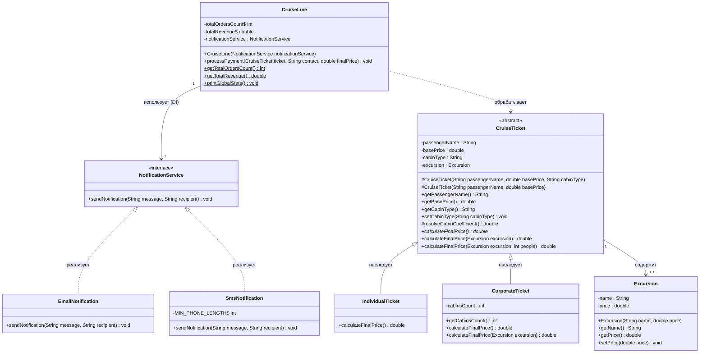

# Лабораторная работа: Блок 2, часть 2 — Наследование, абстрактные классы и интерфейсы

**Язык:** Java 17+  
**Вариант:** 12 — «Билеты на круизный лайнер»

## Описание

Консольная система продажи билетов на круизный лайнер. Билеты бывают двух типов (физические лица и корпоративные клиенты) с разной логикой расчёта стоимости. Оплата фиксируется в системе учёта `CruiseLine`, после чего клиенту отправляется чек. Способ отправки (SMS или Email) внедряется в `CruiseLine` через конструктор (Dependency Injection), поэтому система учёта от него не зависит.

## Тарифы кают

| Тип каюты | Коэффициент |
|---|---|
| `INTERNAL` — внутренняя | 1.00 (+0%) |
| `WINDOW` — с окном | 1.45 (+45%) |
| `SUITE` — люкс с балконом | 2.20 (+120%) |

## Формулы расчёта

- Физическое лицо (`IndividualTicket`): `базовая цена × коэффициент каюты`
- Корпоративный клиент (`CorporateTicket`): `базовая цена × коэффициент каюты × количество кают`
- Экскурсия на одного человека: `цена билета + цена экскурсии`
- Экскурсия на группу (метод из таблицы вариантов): `цена билета + цена экскурсии × число человек`

## Структура проекта

```
src/
├── billing/
│   └── CruiseLine.java            # manager class, сервисный слой, DI
├── model/
│   ├── CruiseTicket.java          # abstract, target class
│   ├── IndividualTicket.java      # билет физлица
│   ├── CorporateTicket.java       # корпоративный билет
│   └── Excursion.java             # option class, экскурсия
├── service/
│   ├── NotificationService.java   # interface
│   └── impl/
│       ├── EmailNotification.java
│       └── SmsNotification.java
└── Main.java                      # демонстрация
```

## Реализованные проверки

- Базовая цена ≤ 0 заменяется на 100.0 с предупреждением в консоль.
- Количество кают в `CorporateTicket` меньше 1 заменяется на 1 с предупреждением.
- Email должен содержать `@` и точку, иначе письмо не отправляется, выводится предупреждение.
- SMS: номер должен начинаться с `+7` или `8` и содержать не менее 11 символов, иначе SMS не отправляется, выводится предупреждение.
- В `resolveCabinCoefficient()` многострочный `switch` с `yield`: в ветке `default` администратору выводится предупреждение.
- Корпоративным клиентам индивидуальная экскурсия не применяется: выводится предупреждение и возвращается стандартная цена.

## UML-диаграмма классов



## Запуск

Через IntelliJ IDEA: откройте проект и запустите `Main.main()`.

Через командную строку (из корня репозитория):

```
javac -encoding UTF-8 -d out $(find src -name "*.java")
java -cp out Main
```

## Пример вывода

```
Физлицо: 30500.00 руб.
[SMS] На номер +79991234567 отправлено сообщение: Оплата билета (Иванов И.И.) принята. Сумма: 30500.00 руб.

Корпорация: 427000.00 руб.
[EMAIL] На адрес office@vector.ru отправлено письмо: Оплата билета (ООО «Вектор») принята. Сумма: 427000.00 руб.

=====================================
   ГЛОБАЛЬНАЯ СТАТИСТИКА CruiseLine
=====================================
Всего оформлено билетов : 2
Суммарная выручка       : 457500.00 руб.
=====================================

--- Проверки ---
[WARNING] Некорректный номер "12345": SMS не отправлено.
[WARNING] Некорректный email "office-vector.ru": письмо не отправлено.
[WARNING] Базовая цена -50.0 некорректна. Установлена минимальная цена 100.0
[WARNING] Количество кают 0 некорректно. Установлено значение 1
[WARNING] Корпоративным клиентам индивидуальная экскурсия не применяется. Возвращена стандартная цена.
Исправленные: цена=100.0, кают=1
```

## Автор

ФИО, группа — _впишите свои данные_
